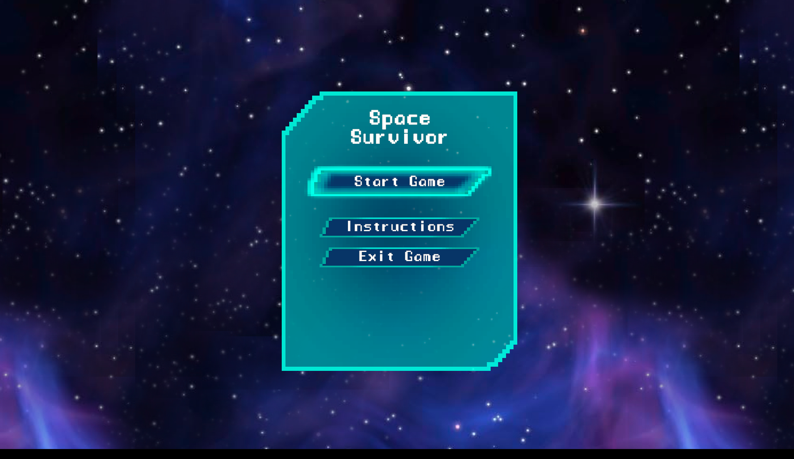
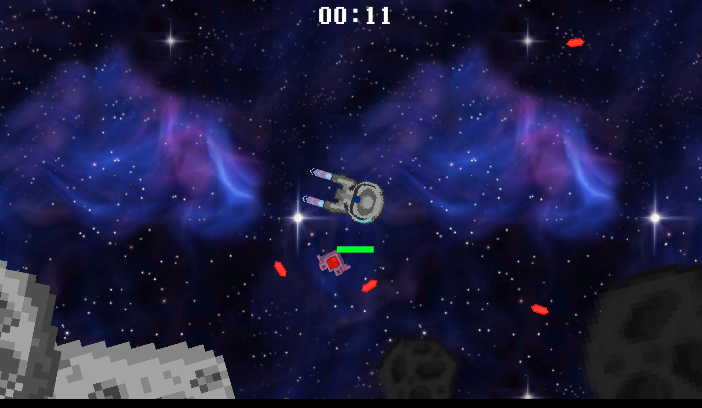
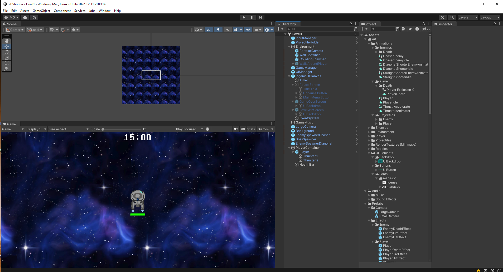

# Space Survivor (2D Space Shooter)

A top-down 2D space shooter made with Unity. Pilot your ship, fend off waves of chasing and shooting enemies, survive the clock and take down the boss to win.




## Controls

| Action | Input |
|---|---|
| Move | `W` `A` `S` `D` / arrow keys |
| Aim | Mouse |
| Shoot | Left mouse button / `Space` |
| Pause | `Esc` |

## Play

Download the latest Windows build from the [Releases](../../releases) page, extract the zip and run `Space Survivor.exe`.

## Development

- Unity **2022.3.20f1** (2D template)
- Packages: Input System, TextMeshPro, 2D feature set

Open the project folder in Unity Hub, then open `Assets/Scenes/MainMenu.unity` and press Play.



### Project layout

```
Assets/
  Art/        sprites, animations, UI elements, fonts
  Audio/      music and sound effects
  Prefabs/    player, enemies, projectiles, effects, cameras
  Scenes/     MainMenu, Level1
  Scripts/    player, enemies, health/damage, projectiles, UI, utilities
```

## Releases

Pushing a version tag on `main` builds the Windows player in GitHub Actions ([GameCI](https://game.ci)) and publishes a release with the zipped build, SHA-256 checksums and a signed build provenance attestation.

```bash
git tag v1.0.0
git push origin v1.0.0
```

The workflow needs three repository secrets for Unity license activation: `UNITY_LICENSE`, `UNITY_EMAIL` and `UNITY_PASSWORD` (see the [GameCI activation guide](https://game.ci/docs/github/activation)).

To verify a download:

```bash
sha256sum -c SHA256SUMS.txt
gh attestation verify space-survivor-v1.0.0-win-x64.zip --repo MMGeri/2d-space-shooter
```

## Credits

Based on the Unity 2D shooter starter project from the Michigan State University Games for Entertainment and Learning (GEL) Lab. The UI font (Manaspace) is used under its own license, found in `Assets/Art/UI Elements/Fonts/manaspc/license.txt`.
